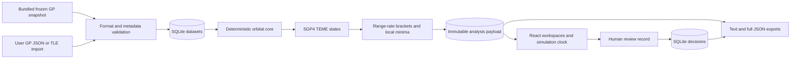

# Architecture

## Implemented local flow

`packages/orbital-core` defines units, types, supported input contracts, propagation, geometry, screening and reporting. There is one SGP4 calculation path in the API. The browser imports pure `geometry` and `removal` subpaths for rendering and transparent educational proxies; it does not load the SGP4/WASM module or run a second TCA search.

The API uses Fastify with Zod body validation. SQLite contains:

| Table               | Purpose                                                 |
| ------------------- | ------------------------------------------------------- |
| `schema_migrations` | Initial schema version marker                           |
| `datasets`          | Full normalized input snapshot and provenance           |
| `analyses`          | Run ID, calculation time and complete immutable payload |
| `decisions`         | Human note linked to an existing run/event              |

Runs embed their input dataset, parameters and engine version. Dataset hashes identify specific serialized inputs; they do not authenticate a provider or create a tamper-proof log. Review author labels are self-declared. There is no update/delete API for saved analyses or decisions, but anyone with local database access can alter them.

Every dataset also stores `inputFormat` and `rawInput`. `contentSha256` is SHA-256 of UTF-8 `JSON.stringify(rawInput)` (including JSON string encoding when the original input was text), not a generic canonical-JSON standard or a hash of the normalized rows. The full JSON export contains both raw and normalized inputs so this digest can be checked without the original machine.

## API lifecycle

1. Select a dataset and a primary/reference object.
2. Validate the requested UTC window, cadence and object IDs.
3. Screen every distinct secondary representation; no coarse distance pruning.
4. Log every propagation failure and identical-element exclusion.
5. Save the full run before returning it.
6. Render sampled trajectories; the saved TCA/miss values remain authoritative.
7. Validate event ownership before appending a review.
8. Export source, hash, parameters, limits and review notes together.

This is a bounded, synchronous, single-process prototype: 2–24 objects, one primary vs. other distinct objects, 1–24 hours, 15–120 s search cadence, ±7 days of the primary epoch. The UI fixes cadence at 30 s. These bounds limit work and model misuse; they are not accuracy or safety criteria. History returns the latest 50 runs.

## Public GitHub Pages edition

`npm run build:pages` exports two reference analyses and their reports through the existing API using an isolated in-memory database, then builds with the `/fetscape/` base path. The browser's public adapter loads this bundled data and only accepts analysis requests whose complete parameters match an exported run. Changed parameters, imports and review writes are rejected rather than mapped to an unrelated cached result. Controls and copy identify the read-only boundary.

The capture state machine and all model inspection, mechanism, fault replay and local JSON download features still run in the browser. Model, evidence and report URLs use Vite's base path. The static client imports no SGP4 runtime; propagation remains in the build-time API path. GitHub Actions tests both the local edition and the static project-path build before uploading and deploying the Pages artifact.

## Plotting contracts

- The globe is an orthographic TEME inertial view. It uses a native SVG Earth/grid, not a geographic basemap, satellite imagery or an Earth-fixed frame.
- Orbit trails show a 90-minute neighborhood from saved 120-second states. Position interpolation is for display only and rejects time gaps larger than one normal interval.
- RIC positions use the instantaneous reference state. The velocity helper subtracts local orbital angular motion; it does not model precession of the reference orbital plane. RIC is not a relative sensor estimate.
- Range chart points are coarse display samples plus the separately refined TCA point, not a high-fidelity continuous uncertainty curve.
- A geometry reminder uses the simulation clock in the open workspace. There is no job scheduler, email/push, browser background service or delivery guarantee.

## First-person synthetic capture lab

The lazy `CaptureLab` route loads Three.js and self-contained optimized GLBs. It uses the pure `@orbit/core/capture` state machine at a fixed 1/120 s step. It does not run SGP4 or ingest the selected target's orbit/physical properties. A selected analysis is context metadata only. `scene.ts` renders simulator truth with the real GLB assets. `mechanism.ts` supplies a staged 8 s sequence and planar IK; `mechanism-rig.ts` skins the supplied robotic-arm vertices and hinges collector parts 3/4 with authored pivots. Capture entry checks are frozen before berthing. Soft attachment starts after finger closure; retraction and latch are kinematic commands, without contact forces or hardware sensing. First-person and external observer cameras share the same state.

The session trace is downloaded as JSON, separate from SQLite analyses/reviews. Teardown cancels RAF, removes keyboard/pointer/resize/visibility listeners, aborts pending asset fetches and disposes GPU resources. The UI pauses on window/visibility loss and displays model-loading/WebGL errors. See `CAPTURE_REHEARSAL.md`.

## Independent pitch evidence

`FaultReplay.tsx` reads the byte-identical public copy of `data/verification/weak-thrust-seed7.json`. It replays a frozen, separate HCW/Kalman study from `research/rpo`; `scripts/verify-rpo-reference.py` reruns the paired case. The comparison never drives the near-field capture controller. Opening it adds its source hash and complete frozen evidence to the session export. The public-data script button runs the API SGP4 path against the bundled snapshot and selects the ISS–DUPLEX wide-separation reference. These three models share a review story, not a unified validated simulation.

## Future pilot architecture — not implemented

Keep the orbital core behind versioned contracts. Add provider-specific connectors with explicit data rights and per-source freshness/uncertainty semantics. Preserve original raw artifacts separately from normalized states.

Large screens should become bounded asynchronous worker jobs with status/progress, cancellation, queue limits and reproducible calculation versions. Avoid simply moving the current synchronous API to a shared public endpoint.

For a customer pilot, add authenticated identities and authorization, tenant isolation, data retention, PostgreSQL/object storage as justified by actual scale, monitoring, backups/restore and integration tests with the partner's data. Choose hosting and database only after deployment, jurisdiction and data-access requirements are known. No cloud account or database has been provisioned here.

An AI layer may retrieve source documentation, explain verified values and draft a report. It should consume structured facts and cite sources. It must not generate orbital states, covariance, Pc, a target's physical properties or spacecraft commands.
